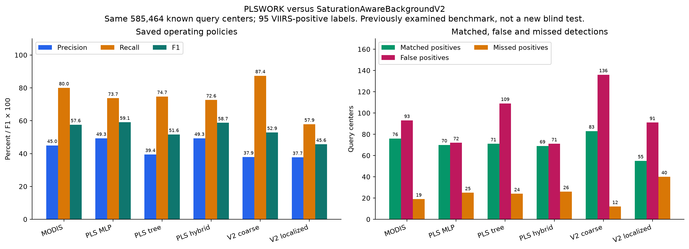

# PLSWORK versus SaturationAwareBackgroundV2

**The PLSWORK MLP has higher precision and F1; V2 coarse has higher recall and more false alarms.** The hybrid is close to the MLP. V2 localization reduces false alarms at a substantial cost in missed positive queries.

All rows use the same 585,464 known query centers, including 95 positive VIIRS labels. Saved policies are applied unchanged. This is a previously examined regional benchmark, not a new blind test.

| Method | Precision | Recall | TP | FP | FN | F1 | AP |
|---|---:|---:|---:|---:|---:|---:|---:|---:|
| VIIRS reference | 100.00% | 100.00% | 95 | 0 | 0 | 1.0000 | 1.0000 |
| Standard MODIS | 44.97% | 80.00% | 76 | 93 | 19 | 0.5758 | 0.3598 |
| PLSWORK contextual MLP | 49.30% | 73.68% | 70 | 72 | 25 | 0.5907 | 0.5556 |
| PLSWORK tree baseline | 39.44% | 74.74% | 71 | 109 | 24 | 0.5164 | 0.5586 |
| PLSWORK neural/tree hybrid | 49.29% | 72.63% | 69 | 71 | 26 | 0.5872 | 0.5586 |
| SaturationAwareBackgroundV2 | 37.90% | 87.37% | 83 | 136 | 12 | 0.5287 | 0.5317 |
| V2 with localization | 37.67% | 57.89% | 55 | 91 | 40 | 0.4564 | — |

VIIRS defines the reference labels, so its perfect row is a self-comparison. It does not establish perfect real-world sensor accuracy. The 95 query labels are correlated and are not 95 independent wildfire incidents.

Compared with the contextual MLP, V2 coarse detects 13 more positive labels in total and produces 64 more false positives. Neither dominates the other across precision and recall. The MLP has the higher F1 at these saved operating points.

## How to read these figures

- `comparison/01_overview`: frozen-policy precision, recall, F1 and detection counts.
- `comparison/02_precision_recall`: ranking curves and the saved operating points. Sweeps are diagnostic; no new threshold was chosen.
- `comparison/03_native_cells`: approximate shared native-cell support with 39 positive cells. This is a distinct target. PLS methods use separately frozen native-cell policies; V2 retains its native detector policy.
- `comparison/04_by_overpass`: all results separated into the three existing test overpasses, with the same count scale.
- `models/`: separate sheets for the MLP, hybrid, tree, V2 coarse, V2 localization, MODIS and the VIIRS reference.
- `spatial/01_shared_scene`: identical scene/crop and common error colors for all methods. White is unknown/excluded, not fire-free.
- `training/01_learning_curves`: saved original training histories. Reconstruction losses and supervised ranking objectives are different.

Every figure has both a PNG and a PDF. Open `index.html` for the local gallery.

## Comparability and limitations

PLSWORK models used VIIRS supervision. Their operating policies use validation labels and a MODIS false-positive budget. V2 used self-supervised MODIS reconstruction with unlabeled day/night alert-volume thresholds, and held out additional training swaths. These are achieved operating points from different procedures, not equal-budget or causal architecture comparisons. The PLS query MLP used its saved BF16 scores; its separately calibrated native-cell comparator uses saved float32 prior scores. The hybrid includes the MODIS fire flag as an input. V2 and the contextual MLP do not.

Model scores have different meanings and units. Raw reconstruction anomalies must not be interpreted as fire probabilities. No Brier/calibration comparison or cross-model raw-score color scale is presented. V2 localization is a binary gated policy and therefore appears as an operating point rather than a separate ranking curve.

The selected spatial tile has the largest positive reference count; it is a display example rather than a typical or independently selected scene. The crop retains every alert from every displayed model within that tile. Full-benchmark statistics include all 84 tiles.

All model weights and source results were read without modification. Exact reference-mask, query-index, label, baseline and cell-ID checks passed. Metrics were independently recomputed and reconciled to the saved evaluations. `metrics.json` contains inputs, hashes and checks; `metrics.csv` contains the comparison values.

