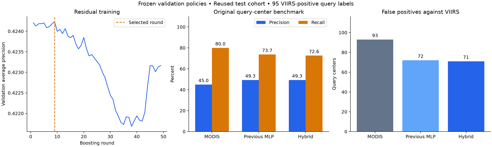
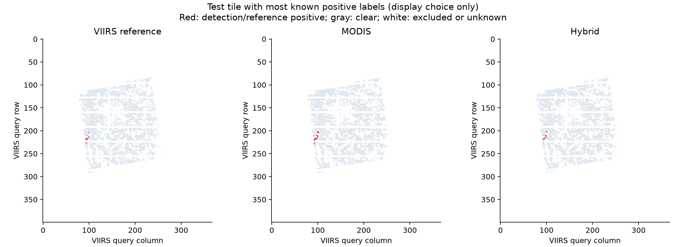

# Contextual neural / residual-tree hybrid

**Completed local training. Previously examined benchmark; not a new blind test.**

The hybrid adds a trained tree correction to the existing frozen neural network logit. It uses MODIS observations and MODIS fire detections at inference; VIIRS provides training/evaluation labels only.

Trained 49 boosting rounds, selected round 9 by validation average precision. All 10,371,908 known training queries and 1,913 positive labels were retained.

On this benchmark, the hybrid changes precision from 44.97% to 49.29%, recall from 80.00% to 72.63%, false positives from 93 to 71, and F1 from 0.5758 to 0.5872.

## Original query-center comparison

Same 585,464 known query centers and 95 positive VIIRS reference labels as the previous experiment. Model thresholds are frozen using validation false-positive budgets before computing this run's test predictions.

| Method | Precision | Recall | TP | FP | FN | F1 | AP |
|---|---:|---:|---:|---:|---:|---:|---:|---:|
| VIIRS reference (self-comparison) | 100.00% | 100.00% | 95 | 0 | 0 | 1.0000 | 1.0000 |
| Standard MODIS | 44.97% | 80.00% | 76 | 93 | 19 | 0.5758 | 0.3598 |
| Previous contextual MLP | 49.30% | 73.68% | 70 | 72 | 25 | 0.5907 | 0.5556 |
| Hybrid at raw 0.5 | 76.00% | 20.00% | 19 | 6 | 76 | 0.3167 | 0.5586 |
| Hybrid, frozen policy | 49.29% | 72.63% | 69 | 71 | 26 | 0.5872 | 0.5586 |

VIIRS is perfect here only because it defines the labels. This is not measured VIIRS accuracy against real fires, and the 95 labels are not 95 independent fire incidents.

## Common native-cell comparison

Each observed native MODIS cell has a positive reference if any eligible VIIRS center assigned to it is positive. The model score is the maximum among the same eligible centers. Thresholds for this scale were fitted separately on validation against the native-cell MODIS FP budget. These are distinct any-fire-in-cell metrics, not improved fine-resolution accuracy. Partially observed cells remain partially observed; an all-negative reference does not establish that the entire physical cell is fire free. Assignment approximates common support, not exact footprint/PSF overlap.

| Method | Precision | Recall | TP | FP | FN | F1 | AP |
|---|---:|---:|---:|---:|---:|---:|---:|---:|
| VIIRS reference (self-comparison) | 100.00% | 100.00% | 39 | 0 | 0 | 1.0000 | 1.0000 |
| Standard MODIS | 76.32% | 74.36% | 29 | 9 | 10 | 0.7532 | 0.5676 |
| MLP, native-cell policy | 78.12% | 64.10% | 25 | 7 | 14 | 0.7042 | 0.7884 |
| Hybrid, native-cell policy | 78.12% | 64.10% | 25 | 7 | 14 | 0.7042 | 0.7897 |

## Preprocessing and architecture

1. Keep the inherited calibrated MODIS radiances, native geolocation inversion, 15-minute maximum pair interval bound, and QA-based unknown masks. The 20 m inverse residual is numerical consistency, not absolute geolocation accuracy.
2. Pool valid 250 m and 500 m reflective samples over their aligned 4x4 and 2x2 blocks to match the native thermal grid. Add seven pooled means, seven local-minus-pooled contrasts, and seven valid fractions. Retain the original 96 features; invalid values never contribute to means.
3. Add the operational MODIS detection flag. This is an available input from MODIS, not a VIIRS label.
4. Freeze the prior 96→64→32→1 MLP. Train up to 300 shallow logistic boosting rounds with its raw score as initial score, learning rate 0.03, 15 leaves, depth at most 4, L2=5, maximum leaf update 1, and validation-AP patience 40.
5. Deploy z = z_MLP + z_residual. The tree export alone is incomplete; the supplied inference command always adds both. Fit a scalar probability offset and detection cutoff on validation only.

This is sequential additive fitting: both stages use the training labels, as boosting normally does. It is not out-of-fold stacking. The old MLP checkpoint was already selected using this validation cohort; the new early stopping and calibration reuse it. That increases development-set dependence.

## Validation comparison

| Method | Precision | Recall | TP | FP | FN | F1 | AP |
|---|---:|---:|---:|---:|---:|---:|---:|---:|
| VIIRS reference (self-comparison) | 100.00% | 100.00% | 1,757 | 0 | 0 | 1.0000 | 1.0000 |
| Standard MODIS | 35.58% | 63.29% | 1,112 | 2,013 | 645 | 0.4556 | 0.2256 |
| Previous contextual MLP | 36.94% | 66.82% | 1,174 | 2,004 | 583 | 0.4758 | 0.4242 |
| Hybrid at raw 0.5 | 53.65% | 26.35% | 463 | 400 | 1,294 | 0.3534 | 0.4242 |
| Hybrid, frozen policy | 36.84% | 66.82% | 1,174 | 2,013 | 583 | 0.4749 | 0.4242 |

## What the research supports

- [Maeda and Tonooka: contextual MOD14 features plus a learned tree classifier](https://pmc.ncbi.nlm.nih.gov/articles/PMC9823964/) supports using physical background contrasts as model inputs. Its Himawari study is not evidence of this MODIS hybrid's accuracy.
- [Friedman: gradient boosting](https://boosting.org/papers/Fri99.pdf) supplies the general method of learning additive corrections under classification loss. The particular MLP-plus-MODIS residual architecture here is our adaptation.
- [Schroeder et al.: satellite active-fire validation](https://www.isprs.org/proceedings/2011/isrse-34/211104015Final00178.pdf) motivates near-coincident observations and comparison at the coarse sensor's support.
- [NASA VIIRS active-fire description](https://viirsland.gsfc.nasa.gov/Products/NASA/FireESDR.html) explains the greater small-fire sensitivity of 375 m VIIRS. Resampling MODIS cannot manufacture that thermal information.
- [LightGBM Dataset API](https://lightgbm.readthedocs.io/en/stable/pythonapi/lightgbm.Dataset.html) documents initial scores; deployment and validation consistency are also checked numerically in this experiment.

## Limits and interpretation

No new satellite data or packages were downloaded. The model is an active-fire reference detector, not a future-fire forecast. The copied corpus has three training regional cohorts and only one cohort each for validation and testing. Correlated query centers cannot support an independent-trial confidence claim. The same test region has influenced earlier architecture discussions, so a fresh held-out event cohort is necessary before claiming general improvement. This run does not isolate each new feature's causal contribution; the unchanged MLP is the zero-residual comparator. No threshold was retuned after this test.

