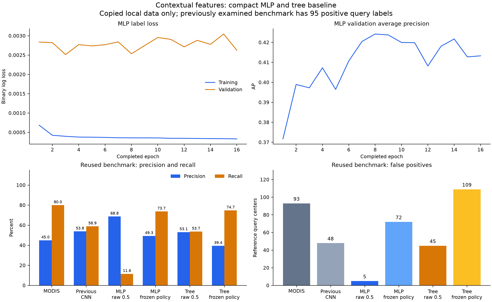

# Completed contextual MLP experiment

The requested new folder contains a complete, executed training pipeline.
**No new satellite data were downloaded.** A physical, checksum-verified copy of
1,218 local files (10.97 GiB) supplies the existing raw-source provenance,
prepared imagery, labels and prior supervised checkpoint.

## What trained

The new model is an **8,321-parameter MLP** on 96 explicit MODIS features: thermal
radiances, annular background statistics and contrasts, original finer-resolution
reflective measurements, geometry and offsets within native cells. It uses
`96 → 64 → 32 → 1` layers with GELU and dropout. Its inputs do not include VIIRS
imagery, VIIRS labels, MODIS fire detections or absolute geographic coordinates.

All **10,371,908 known training queries** from 844 tiles were retained, including
1,913 positive reference labels. Scaling was fitted on training data only.
Validation contains 172 tiles and test contains 84, with 95 positive test queries.

MLP training stopped after 16 epochs under the configured patience rule, selecting
epoch 8 by exact validation average precision (0.42420). A LightGBM baseline on
the same features stopped after 199 iterations, selecting iteration 169 with
validation average precision 0.37397. The **MLP was selected using validation**;
its policy was then frozen before benchmark prediction.

## Reused benchmark results

All comparisons use the same 585,464 eligible reference query centers. The MLP
policy below was fitted to the MODIS false-positive budget on **validation**; it
was not tuned to this benchmark.

| Method | Precision | Recall | TP | FP | FN | F1 |
|---|---:|---:|---:|---:|---:|---:|
| VIIRS reference labels (self-comparison) | 100.00% | 100.00% | 95 | 0 | 0 | 1.0000 |
| Regular MODIS | 44.97% | 80.00% | 76 | 93 | 19 | 0.5758 |
| Previous supervised CNN, raw 0.5 | 53.85% | 58.95% | 56 | 48 | 39 | 0.5628 |
| New MLP, raw 0.5 | 68.75% | 11.58% | 11 | 5 | 84 | 0.1982 |
| New MLP, frozen validation policy | 49.30% | 73.68% | 70 | 72 | 25 | 0.5907 |
| Tree, raw 0.5 | 53.12% | 53.68% | 51 | 45 | 44 | 0.5340 |
| Tree, frozen validation policy | 39.44% | 74.74% | 71 | 109 | 24 | 0.5164 |

VIIRS defines the reference labels in this evaluation. Its row is therefore a
self-comparison, perfect by definition, not an independent measurement of VIIRS
accuracy against real fires. The 95 positives are eligible nominal/high-confidence
VIIRS query labels in these copied test tiles, not all VIIRS detections or 95
independent wildfire incidents. Independent ground observations would be needed
to evaluate VIIRS accuracy itself.

**The new MLP policy improves precision and F1 and reduces false positives
relative to regular MODIS, but detects six fewer positive queries.** False
positives fall from 93 to 72 (22.6% fewer); recall falls from 80.00% to 73.68%.
F1 rises from 0.5758 to 0.5907. This is a useful tradeoff on this benchmark,
not the desired unambiguous gain of detecting at least as many positives with
no additional false alarms.

Its exact test average precision is 0.55562, compared with regular MODIS's 0.35980
and the previous CNN's recomputed 0.50027. The tree's AP is slightly higher on this
benchmark (0.55862), but it was not selected because its validation AP was lower.
No model was reselected after these benchmark results.

Raw MLP probabilities at 0.5 are too conservative, detecting only 11 of 95
positives. The validation-fitted operating policy, not the unadjusted default
threshold, provides the reported MLP F1 tradeoff. The saved inference output
separately names raw probabilities and frozen-policy detections.

**This is not a fresh blind test.** The validation cohort and 2024 scenes were
examined in earlier runs. The dataset is still small in terms of independent
events; query labels are correlated. VIIRS provides reference activity, not
independently verified wildfire truth. More varied development events and a new
untouched test cohort are needed before claiming a general improvement.

## Completion evidence

All 13 tests are covered successfully across the existing GPU and LightGBM
environments. Tests include input-label isolation, annular statistics, masks,
finer-lattice sampling, training-only normalization, retained exposure, feature
tamper rejection, validation-only policies, native tree reload, strict MLP reload,
label-free inference and a CUDA/BF16 optimizer update.

The completion verifier rechecked all 1,218 copied file hashes and the software
lock, matched the inference export to the selected MLP weights, checked the
copied baseline hash, and ran both models on an input-only tile with no target or
VIIRS fields. The original folders and checkpoints were not modified by this
experiment. MLP inference defaults to CPU float32; benchmark scoring used CUDA
BF16, so small differences near thresholds can occur between execution modes.

The new folder owns all experiment code, data, features, models and results. It
reuses the previously installed Python runtimes from the sibling folders; it
does not install or download dependencies automatically.

Run the complete cached workflow with `run-training.cmd` or inspect individual
stages in the [README](../README.md).

[Full evaluation](EVALUATION.md) · [Metrics](metrics.csv) ·
[Frozen policy](operating_policy.json) · [Completion verification](completion_verification.json) ·
[MLP export](../models/mlp/inference.pt) · [Local copy receipt](local_copy_receipt.json)
