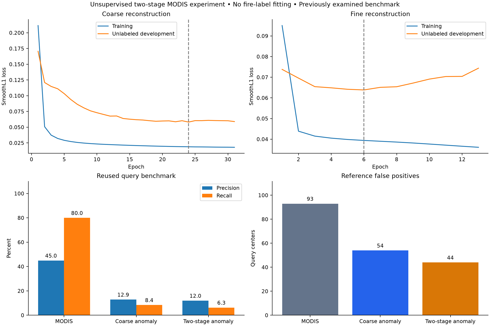

# Unsupervised MODIS background learning and two-stage detection

**Completed fitting without VIIRS or MODIS fire labels. The benchmark was examined in earlier experiments; this is not a new blind test.**

Two small networks predict withheld MODIS measurements from background context. Positive reconstruction residuals identify thermal anomalies. The first detects native thermal-cell anomalies. The second narrows supported daytime detections to 500 m samples using band 7 evidence. These are anomaly scores and relative localization weights, not calibrated fire probabilities.

## Training

| Stage | Training samples | Development samples | Parameters | Epochs completed | Selected epoch |
|---|---:|---:|---:|---:|---:|
| coarse | 3,204,188 | 689,675 | 6,306 | 31 | 24 |
| fine | 4,605,619 | 2,761,434 | 4,993 | 13 | 6 |

Checkpoint selection minimizes reconstruction loss on unlabeled development MODIS observations. Feature and target normalization use training measurements only. Neither checkpoint selection nor thresholds use the reference labels. The training corpus may contain fires: robust SmoothL1 regression limits the influence of large errors but does not guarantee a fire-free learned background.

## Frozen operating policy

The native detector flags approximately the top 0.1% of unlabeled development anomaly scores within day/night groups; ties are handled conservatively. The localization stage requires valid observations in all four child samples and a maximum shortwave residual above the unlabeled 99th percentile. It then retains the top two child scores, including ties. Without adequate evidence it retains the whole coarse cell and marks localization unresolved. Alert-volume fractions are engineering choices made before reference evaluation; they are not measured false-positive rates. A group with fewer than 1,000 development samples uses the pooled development distribution, explicitly recorded in policy.json.

## Original query-center benchmark

Same known VIIRS query centers as earlier comparisons. Model-unusable locations remain in the denominator as undetected; they are not removed to improve scores. The fine branch produces 500 m localization, sampled at the query centers; it does not create 375 m thermal measurements.

| Method | Precision | Recall | TP | FP | FN | F1 | AP |
|---|---:|---:|---:|---:|---:|---:|---:|---:|
| VIIRS_reference_self_comparison | 100.00% | 100.00% | 95 | 0 | 0 | 1.0000 | 1.0000 |
| standard_MODIS | 44.97% | 80.00% | 76 | 93 | 19 | 0.5758 | 0.3598 |
| unsupervised_coarse | 12.90% | 8.42% | 8 | 54 | 87 | 0.1019 | 0.0169 |
| unsupervised_two_stage | 12.00% | 6.32% | 6 | 44 | 89 | 0.0828 | — |

VIIRS is the reference: its perfect self-comparison does not establish true sensor accuracy. AP is shown for the coarse continuous anomaly score. The localization rule produces a gated binary mask, so no separate fine-stage AP or probability-calibration claim is made.

## Native MODIS-cell benchmark

A reference cell is positive if any eligible VIIRS center assigned to it is positive. This approximates native-cell support, not exact footprint overlap. Partially observed cells remain partially observed. Both stages share the same native-cell alert decision; localization only refines where within the cell an alert is placed.

| Method | Precision | Recall | TP | FP | FN | F1 | AP |
|---|---:|---:|---:|---:|---:|---:|---:|---:|
| VIIRS_reference_self_comparison | 100.00% | 100.00% | 39 | 0 | 0 | 1.0000 | 1.0000 |
| standard_MODIS | 76.32% | 74.36% | 29 | 9 | 10 | 0.7532 | 0.5676 |
| unsupervised_coarse | 29.41% | 12.82% | 5 | 12 | 34 | 0.1786 | 0.0827 |

On the query benchmark, localization removed **10 false-positive queries** and **2 true-positive queries** from the coarse-only prediction. Across all native test outputs, 33 of 61 alerts had supported localization. Model-valid coverage of the known query benchmark was 98.57%.

## Development-set evaluation, performed only after freezing

| Method | Precision | Recall | TP | FP | FN | F1 | AP |
|---|---:|---:|---:|---:|---:|---:|---:|---:|
| VIIRS_reference_self_comparison | 100.00% | 100.00% | 1,757 | 0 | 0 | 1.0000 | 1.0000 |
| standard_MODIS | 35.58% | 63.29% | 1,112 | 2,013 | 645 | 0.4556 | 0.2256 |
| unsupervised_coarse | 18.67% | 20.55% | 361 | 1,573 | 1,396 | 0.1956 | 0.0694 |
| unsupervised_two_stage | 19.32% | 20.32% | 357 | 1,491 | 1,400 | 0.1981 | — |

## Methods and limits

- Stage 1 predicts central log-radiances for bands 20 and 22 from annular neighborhood summaries, central longwave bands 31/32, and viewing/solar geometry. All thermal neighborhood summaries exclude the central 3x3 region. The central target-band measurements are absent from the predictor.
- Stage 2 predicts daytime central band-7 log-reflectance from annular context, central visible bands, pooled 250 m bands and geometry. Its own central 3x3 band-7 region is excluded. Relative child weights sum to one within each native cell; they indicate concentration, not calibrated uncertainty.
- Inputs are strict MODIS-only files. VIIRS references and MODIS fire masks reside in physically separate evaluation files. Test imagery is not used for feature normalization, fitting, early stopping, residual normalization or thresholds.
- Copying the existing paired-scene dataset does not undo its upstream selection: it is a small curated corpus, with three training regional cohorts and one each for development and test. Nearby cells are correlated. The unsupervised claim applies to this experiment's parameter fitting and policy selection, not to an uncurated global sampling process.
- Anomalies may be hot ground, reflections, cloud boundaries or calibration artifacts; fire can also be reconstructed as normal. No performance improvement is assumed, and no post-reference threshold adjustment is performed.

## Research basis

[Masked self-supervised satellite learning (SatMAE)](https://sustainlab-group.github.io/SatMAE/) motivates learning from withheld measurements. This implementation uses compact blind-spot regressors, not the SatMAE architecture.
[Thermal autoencoder anomaly-detection feasibility study](https://www.mdpi.com/2313-433X/12/6/229) motivates background reconstruction. That work uses a different sensor and reference-guided development; its reported performance does not transfer here.
[USGS daytime MODIS 500 m fire-location prototype](https://www.usgs.gov/publications/prototype-downscaling-algorithm-modis-satellite-1-km-daytime-active-fire-detections) supports the physical rationale for using band-7 shortwave evidence within a coarse alert. The present learned residual rule is an experimental adaptation.

