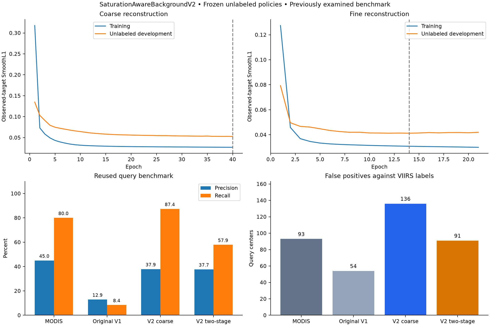

# SaturationAwareBackgroundV2: corrected unsupervised experiment

**The prior test cohort has been examined and its saturation failures informed this repair. This is development evidence, not a new blind test.**

Both networks are trained from scratch. No VIIRS labels or MODIS fire flags enter fitting, normalization, checkpoint selection or threshold calibration. The original model, weights, outputs and reports are preserved.

## Same query-center benchmark

All methods below use the original 585,464 eligible reference locations and 95 positive labels. Model-invalid queries stay in the denominator as undetected. VIIRS defines the labels, so its perfect row is a self-comparison, not real-world sensor accuracy.

| Method | Precision | Recall | TP | FP | FN | F1 | AP |
|---|---:|---:|---:|---:|---:|---:|---:|---:|
| VIIRS reference (self-comparison) | 100.00% | 100.00% | 95 | 0 | 0 | 1.0000 | 1.0000 |
| Standard MODIS | 44.97% | 80.00% | 76 | 93 | 19 | 0.5758 | 0.3598 |
| Original V1, coarse | 12.90% | 8.42% | 8 | 54 | 87 | 0.1019 | 0.0169 |
| Original V1, two-stage | 12.00% | 6.32% | 6 | 44 | 89 | 0.0828 | — |
| SaturationAwareBackgroundV2, coarse | 37.90% | 87.37% | 83 | 136 | 12 | 0.5287 | 0.5317 |
| SaturationAwareBackgroundV2, two-stage | 37.67% | 57.89% | 55 | 91 | 40 | 0.4564 | — |

## Input coverage

The corrected model can score **95/95 positive queries (100.00%)**, versus 20/95 for V1. Negative-query coverage is 100.00%. Positive query channel selection: {'0': 0, '21': 68, '22': 27}. Coverage is not detection: the anomaly score must still exceed its frozen threshold.

## Native MODIS-cell benchmark

Reference any-fire labels and maximum model score use the same observed query centers assigned to each native cell. This approximates common support, not exact physical footprints. Partial observation does not prove a whole cell is fire-free. The two-stage branch preserves the parent native alert; only within-cell query localization can change.

| Method | Precision | Recall | TP | FP | FN | F1 | AP |
|---|---:|---:|---:|---:|---:|---:|---:|---:|
| VIIRS reference (self-comparison) | 100.00% | 100.00% | 39 | 0 | 0 | 1.0000 | 1.0000 |
| Standard MODIS | 76.32% | 74.36% | 29 | 9 | 10 | 0.7532 | 0.5676 |
| SaturationAwareBackgroundV2, coarse | 61.54% | 82.05% | 32 | 20 | 7 | 0.7033 | 0.7391 |

## What changed

- Predict band-21 and band-22 radiances with separate outputs and normalize each from its own observed training values. Mask unavailable targets from both loss numerator and denominator. Prefer the standardized band-22 anomaly when available, otherwise use band 21. No simultaneous two-band anomaly is required. No numeric radiance is invented for saturation or fill codes.
- Continue to fit only disjoint halo-16 native interiors. Predict across cells with complete radius-10 background context, which includes native cells covering the inherited continuous-query halo boundary. This avoids dropping query locations merely due to nearest-cell rounding.
- Deterministically hold out complete training swaths within region/day-night groups, retaining at least one fitting swath in each group. Add the inherited validation swath to the unlabeled development set. These swaths are excluded from training statistics and optimizer updates. This repairs missing nighttime calibration but changes the training/development composition, so V1/V2 differences are not a single-factor ablation.
- Keep the 0.1% coarse and 1% localization development alert-volume fractions fixed. No reference-guided threshold search is performed. Day and night each require at least 1,000 development samples per target channel; no daytime fallback is used for night.
- Retain the experimental daytime 500 m localization rule: require four valid shortwave samples and strong residual evidence, then keep the highest two child scores including ties; preserve the unresolved full cell otherwise. Relative weights are not calibrated fire probabilities.

## Fitting and calibration

Whole-swath counts by role: {'train': 8, 'development': 5, 'test': 3}. Four existing training swaths are held out when the configured stratum sizes permit it.

| Stage | Training samples | Development samples | Epochs completed | Selected epoch | Parameters |
|---|---:|---:|---:|---:|---:|
| coarse | 1,696,366 | 2,198,395 | 40 | 40 | 6,306 |
| fine | 1,941,171 | 5,425,882 | 21 | 14 | 4,993 |

Nighttime calibration now has **841,856 unlabeled native-cell samples**. Checkpoints minimize observed-target SmoothL1 reconstruction loss. Anomaly thresholds use the held-out MODIS score distribution. Alert fractions are not false-positive guarantees; anomaly scores are not fire probabilities.

## Localization effect

On the query benchmark, localization removed 45 false positives and 28 true positives. Across full test tile outputs, 69 of 118 native alerts had supported localization.

## Inherited validation-cohort comparison

This is only the original validation cohort, not all newly held-out development swaths. Evaluation labels are opened after the models and policies are frozen.

| Method | Precision | Recall | TP | FP | FN | F1 | AP |
|---|---:|---:|---:|---:|---:|---:|---:|---:|
| VIIRS reference (self-comparison) | 100.00% | 100.00% | 1757 | 0 | 0 | 1.0000 | 1.0000 |
| Standard MODIS | 35.58% | 63.29% | 1112 | 2013 | 645 | 0.4556 | 0.2256 |
| Original V1, coarse | 18.67% | 20.55% | 361 | 1573 | 1396 | 0.1956 | 0.0694 |
| Original V1, two-stage | 19.32% | 20.32% | 357 | 1491 | 1400 | 0.1981 | — |
| SaturationAwareBackgroundV2, coarse | 32.44% | 79.00% | 1388 | 2891 | 369 | 0.4599 | 0.3722 |
| SaturationAwareBackgroundV2, two-stage | 32.41% | 65.11% | 1144 | 2386 | 613 | 0.4328 | — |

## Interpretation limits and research

The experiment uses the existing selected paired-scene corpus, not a global random MODIS sample. Repeatedly observed regional events and nearby query labels are correlated. Reconstruction loss is not a direct objective for fire discrimination; anomalies can be clouds, reflections or hot ground. A successful coverage repair does not by itself establish improvement over MODIS. Independent fire events remain necessary.

[NASA MODIS calibration ATBD](https://mcst.gsfc.nasa.gov/sites/default/files/file_attachments/MODIS_L1B_ATBD_ver8_finalupload.pdf) describes low-gain band 21 for fire measurements. [NASA file specification](https://ladsweb.modaps.eosdis.nasa.gov/filespec/MODIS/5/MOD021KM.fs) documents saturation code 65533. [USGS MODIS 500 m localization prototype](https://www.usgs.gov/publications/prototype-downscaling-algorithm-modis-satellite-1-km-daytime-active-fire-detections) motivates shortwave localization; the residual rule here is an experimental adaptation.

