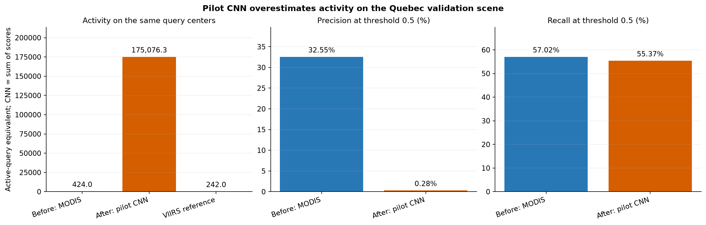
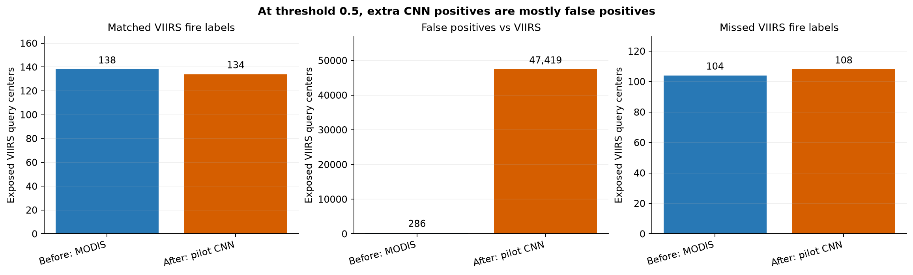
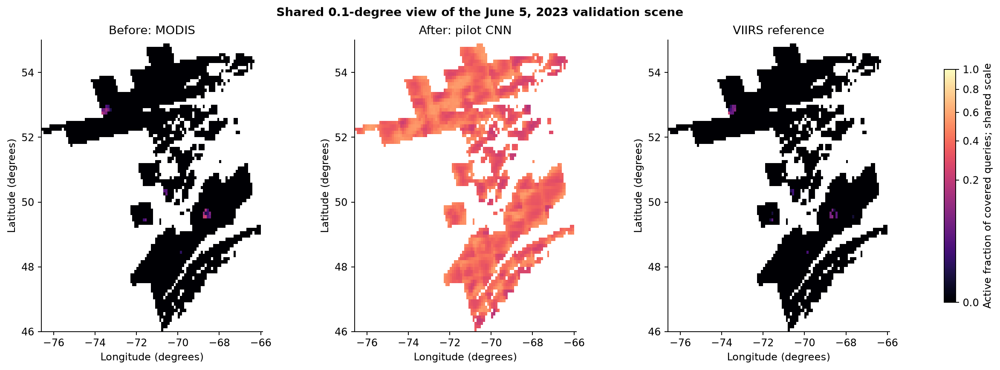
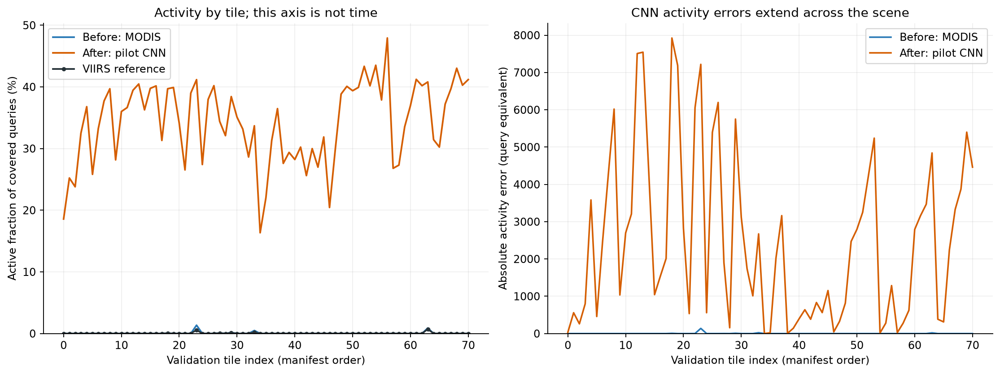
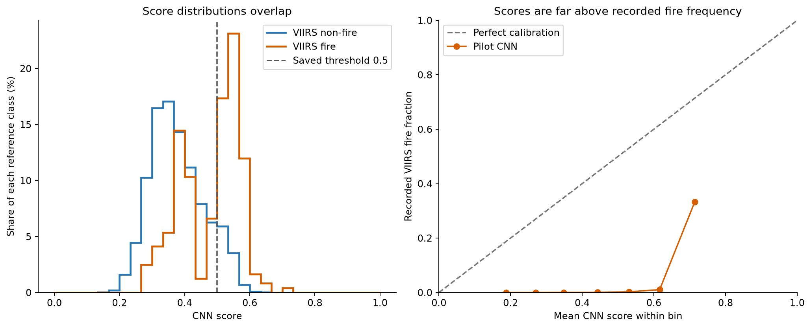

# Before and after native-resolution harmonization: real_training_pilot_v1

**This one-epoch pilot performs substantially worse than the observed MODIS baseline on its Quebec validation scene. Keep it experimental.** [1]

The comparison follows the earlier [coarse-grid evaluation](../../../fire-harmonization-research/results/EVALUATION.md): observed MODIS before, frozen model estimates after, and observed VIIRS as reference. The native target is a recorded VIIRS query fire label, so its numbers are not directly comparable to the older weighted cell-day metrics.

## What the results support

- On **462,751 covered query centers**, observed VIIRS contains **242 fire labels**. MODIS marks **424** centers active; the CNN marks **47,553** at the saved **0.5** threshold. [1]
- CNN false positives rise from **286 to 47,419**, while matched VIIRS positives fall from **138 to 134**. Precision falls from **32.55% to 0.28%**; recall falls from **57.02% to 55.37%**. [1]
- Summing the CNN scores yields **175,076.3 active-query equivalents**, versus **242** recorded VIIRS positives: **72,245.6%** bias. These scores are not validated probabilities or counts of independent fires. The corresponding MODIS bias is **+75.2%**. [1]
- CNN Brier loss is **0.149779**, versus **0.000843** for MODIS and **0.000523** for an always-zero reference baseline. The validation prevalence is only **0.0523%**; the zero baseline's small loss does not make it useful for finding fires. [1]

## Why the pilot should remain experimental

Training completed **one epoch** using **54 western-Canada tiles** from **2023-07-01**, with only **7 positive query labels**. Validation uses **71 Quebec tiles** from **2023-06-05**, with positives in **7 tiles**. It covers one MODIS acquisition paired with **2 adjacent VIIRS granules**; those tiles are not independent events. [2]

Validation groups, source files, tile IDs and buffered geographic footprints are separated from training. However, this same validation set was used to choose the saved best checkpoint; it is **not an untouched test set**. Its date is also earlier than the training date, so this is a spatial scene comparison, not forward temporal validation. No aggregate uncertainty interval or independent-event generalization claim is supported. [2]

Sparse training positives and the short run are possible contributors to failure, but this evaluation does not establish a cause. The slight ROC AUC advantage does not offset the much worse precision, average precision and activity totals. Do not tune a threshold on this scene and then describe its result as independent testing.

## Matched detection and score metrics

All comparisons use the same covered query centers and the saved 0.5 threshold. Ranking metrics below use exact tied-score groups; the native evaluator's [raw report](report.json) uses an approximate 4096-bin histogram. Hard MODIS flags are treated as scores 0/1, so their log loss is sensitive to the shared clipping convention. [1]

| Metric | Before: MODIS | After: pilot CNN |
|---|---:|---:|
| Precision | 32.55% | 0.28% |
| Recall | 57.02% | 55.37% |
| F1 | 0.4144 | 0.0056 |
| Brier loss (lower is better) | 0.000843 | 0.149779 |
| Log loss (lower is better) | 0.023287 | 0.484474 |
| ROC AUC (exact) | 0.7848 | 0.7974 |
| Average precision (exact) | 0.1858 | 0.0093 |

## Before/after figures

The maps share one scale and show active fractions among covered query centers in 0.1-degree display bins. Blank bins have no eligible exposure. The display bins do not change the native evaluation target. The tile index is spatial manifest order, not a timeline. All chart values are available in the accompanying CSV files. [1]



[Editable SVG](../../visualizations/real_training_pilot_v1_evaluation/01_before_after_summary.svg)



[Editable SVG](../../visualizations/real_training_pilot_v1_evaluation/02_detection_errors.svg)



[Editable SVG](../../visualizations/real_training_pilot_v1_evaluation/03_spatial_before_after.svg)



[Editable SVG](../../visualizations/real_training_pilot_v1_evaluation/04_tile_activity_errors.svg)



[Editable SVG](../../visualizations/real_training_pilot_v1_evaluation/05_probability_diagnostics.svg)

## Interpretation limits and next step

Labels are VIIRS nominal/high-confidence fire classes 8/9 versus observed land class 5, with the pipeline's QA and geometric exclusions. Cloud, water, low-confidence fire and unknown classes are excluded rather than interpreted as non-fire. The MODIS baseline is the native fire flag sampled at those VIIRS query centers. Geometric interpolation residuals do not validate absolute ground location. [3]

This is an **all-land thermal-activity pilot**, not a forest-only wildfire model. Reference disagreement can include sensor resolution, label policy and acquisition-time differences (up to 15 minutes allowed by pairing). Neither source is independent wildfire ground truth. Active queries are not burned area, unique incidents or reconstructed subpixel fire locations.

The older summer totals, weekly profiles, burning calendars, multi-region comparisons and power-law benchmark cannot be reproduced from this one-scene validation set with the same meaning. The earlier power law was fitted to coarse weekly occupied-cell totals; applying it directly to native binary query labels would change the target without validation.

Retain the MODIS baseline. Before further claims, add multiple geographically and temporally separated fire-rich training scenes plus a separately reserved test set. Use development validation for checkpoint selection and any calibration; compare precision, recall, activity bias and timing against MODIS on the untouched test set. A longer run alone would not establish improvement.

## Evidence and reproducibility

1. [Frozen evaluation output](report.json), [independently recomputed metrics](visual_evaluation.json), [metric table](metrics.csv), [per-tile values](visual_evaluation_by_tile.csv), [map values](spatial_figure_data.csv), and [calibration values](calibration_figure_data.csv).
2. [Training record](../../logs/real_training_pilot_v1/epochs.jsonl), [run configuration](../../models/real_training_pilot_v1/run.json), [split audit](../real_training_pilot_v1_audit.json), and [execution verification](../real_training_pilot_v1_execution.json).
3. [Native label and geometric eligibility code](../../src/firefullres/geometry.py) and [MODIS baseline preparation](../../src/firefullres/prepare.py).

Checkpoint: `models/real_training_pilot_v1/last.pt`; SHA-256 `2df55ba0ad714b401939e698d6d9df5e9bdc316f080d55bf57a5a011978e6d78`. Predictions and input tiles were checked against their saved hashes; counts, exposure masks, coordinates and direct losses were independently reconciled. All **462,751** exposed coordinates are unique within the validation scene. The existing checkpoint and training data are unchanged.

From the repository root, reproduce with:

```powershell
& 'fire-harmonization-research-fullres/.venv/Scripts/python.exe' 'fire-harmonization-research-fullres/run.py' evaluate --manifest data/manifests/real_training_pilot_v1.jsonl --checkpoint models/real_training_pilot_v1/last.pt --split validation --device cuda --output results/real_training_pilot_v1_evaluation_NEW
& 'fire-harmonization-research-fullres/.venv/Scripts/python.exe' 'fire-harmonization-research-fullres/tools/summarize_pilot_evaluation.py' --evaluation results/real_training_pilot_v1_evaluation_NEW
```

Use a fresh evaluation output directory; the evaluator refuses to overwrite existing predictions. Plotting only needs the saved predictions and does not fit a model or alter the threshold.
