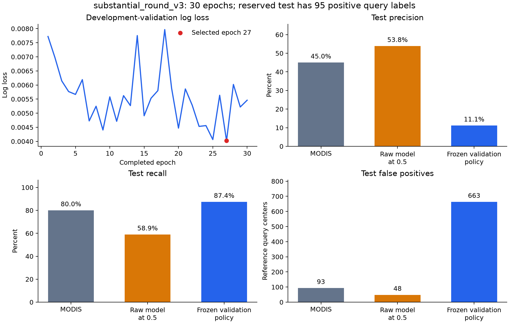

# Completed real-data training round

Completed all **30 epochs** on the RTX 5070. The run processed all 844 training
tiles in every epoch: 25,320 tile presentations and 2,280 optimizer updates.
Training, validation and checkpoint writing took **8 minutes 28 seconds**;
NASA downloads and native-image preparation took additional time.

The selected checkpoint is **epoch 27**, chosen by development-validation log
loss (0.00402224). The final epoch-30 checkpoint is retained separately.

## Data actually admitted

| Partition | Tiles | Positive reference query labels | Regional cohorts |
|---|---:|---:|---:|
| Training | 844 | 1,913 | 3 |
| Validation | 172 | 1,757 | 1 |
| Test | 84 | 95 | 1 |

The earlier pilot had only seven positive training labels. This run has far more
training support and a separately reserved test set. Its observations are still
correlated within acquisition cohorts; 95 test query labels are not 95 independent
fires. Ontario candidates yielded no eligible native tiles, so validation remains
limited to the Quebec development cohort. This is an all-land VIIRS-reference
classification experiment, not an operational or forest-only wildfire model.

## Reserved test results

All methods were assessed on the same 585,464 known reference query centers.
The raw 0.5 threshold was configured before training. The adjusted operating
policy was fitted on validation and frozen before test prediction.

| Method | Precision | Recall | True positives | False positives | Missed positives |
|---|---:|---:|---:|---:|---:|
| MODIS | 44.97% | 80.00% | 76 | 93 | 19 |
| Raw model at 0.5 | 53.85% | 58.95% | 56 | 48 | 39 |
| Validation-adjusted model, frozen policy | 11.13% | 87.37% | 83 | 663 | 12 |

**The raw model offers a tradeoff, not a clear replacement for MODIS:** it has
higher precision and 45 fewer false positives, but detects 20 fewer positive
query labels. Its test F1 is 0.563 versus MODIS's 0.576.

**The validation adjustment did not transfer well.** It increases test recall,
but its 663 false positives are about 7.1 times MODIS's 93. Matching the MODIS
false-positive budget on validation did not guarantee that budget on test.
Keep MODIS as the baseline; this adjusted policy is not supported for deployment.
No threshold or intercept was retuned after seeing these test results.

The raw model has promising test ranking: exact ROC AUC 0.99835 and average
precision 0.50024, compared with MODIS average precision 0.35980. Its raw test
Brier score is 0.00012577 versus MODIS's 0.00019130. These findings do not establish
reliable probabilities or broad usefulness: raw scores sum to 282.2 active-query
equivalents against 95 observed positives; adjusted scores sum to 715.7.
Independent fire events and more varied validation coverage remain necessary.

The old pilot's pooled counts cannot be directly compared with these new counts,
because the scenes and admitted query coverage differ. Use the matched comparisons
above and the complete [evaluation](EVALUATION.md).

## Reproducibility and verification

- Version 2 stopped before training when its 384-pixel query canvas admitted too
  little data. Version 3 uses a 768-pixel limit, with the same frozen source bundles,
  geographic blocks, label rules and minimum data requirements. The old source
  snapshot and failed admission audit are preserved.
- 212 reused source files, totaling 16.018 GiB, matched their recorded checksums.
  The original pilot checkpoint remains unchanged. No Earthdata credentials were
  saved to project files or journals.
- All 64 software tests passed after the preparation correction. The actual-data
  CUDA profile passed, and the training run peaked at 3.87 GiB reserved GPU memory.
- The selected checkpoint reloaded strictly into the model on CPU. Its hash and
  the dataset hash match the sealed evaluation, and its epoch matches the best
  validation-log-loss selection. The final checkpoint records all 30 epochs.

Artifacts: [evaluation JSON](evaluation.json), [metrics CSV](metrics.csv),
[frozen calibration](calibration.json), [dataset audit](dataset_audit.json),
[source integrity](inherited_source_integrity.json),
[completion checks](completion_verification.json), [execution log](execution.log).

Checkpoints: [best](../../models/substantial_round_v3/best.pt),
[last](../../models/substantial_round_v3/last.pt).
Generic `run.py infer` emits raw model scores; the separate adjustment is applied
only by this round's evaluation tool.
