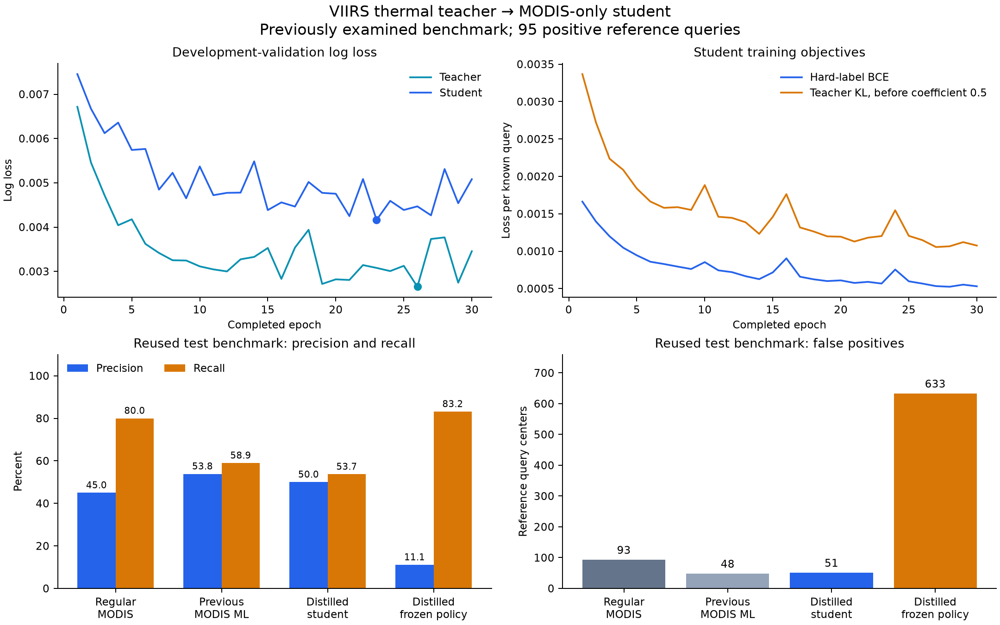

# Completed VIIRS teacher / MODIS student experiment

The requested teacher–student pipeline is implemented and has been run end to
end on real NASA imagery. Both networks completed **30 epochs**. The exported
student requires **MODIS inputs only**.

**This first distillation run did not improve the previous supervised ML model
on the reused 2024 benchmark.** Its default-threshold precision, recall, F1,
average precision and Brier score are all worse than the previous ML checkpoint.
The previous checkpoint remains unchanged; no automatic promotion was made.

## What was implemented and run

- Downloaded 17 exact VIIRS VNP02IMG companions: 3.593 GiB of new transfers.
- Calibrated I04/I05 thermal radiances using the files' scale/offset and quality
  flags. Matched each teacher crop exactly to the frozen query coordinates.
- Retained all parent partitions: 844 training tiles, 172 validation tiles and
  84 test tiles. Training has 1,913 positive reference query labels; test has 95.
- Trained a 488,145-parameter VIIRS thermal teacher for 30 epochs. Epoch 26 was
  selected by validation log loss. Its validation average precision is 0.70145,
  with Brier 0.00059085 versus always-clear 0.00092654; it passed the quality gate.
- Froze that checkpoint and cached logits for exactly the 844 training tiles.
  No validation/test soft-target cache was created.
- Trained the original 1,982,050-parameter MODIS network from the same seed and
  with the same configuration and normalizers as the supervised baseline.
  The added objective is masked, two-class Bernoulli KL with **temperature 2**,
  **temperature-squared scaling**, and **coefficient 0.5**. Full hard-label and
  native auxiliary supervision remain active.
- Completed 30 student epochs and selected epoch 23 by validation log loss.
  Exported its weights and preprocessing metadata without teacher or optimizer
  state. The existing MODIS checkpoint loader reloaded the export successfully.

## Reused 2024 benchmark

All methods use the same 585,464 known reference query centers.

| Method | Precision | Recall | True positives | False positives | Missed positives | F1 |
|---|---:|---:|---:|---:|---:|---:|
| Regular MODIS | 44.97% | 80.00% | 76 | 93 | 19 | 0.5758 |
| Previous supervised MODIS ML, raw 0.5 | 53.85% | 58.95% | 56 | 48 | 39 | 0.5628 |
| Distilled MODIS student, raw 0.5 | 50.00% | 53.68% | 51 | 51 | 44 | 0.5178 |
| Distilled student, frozen validation policy | 11.10% | 83.16% | 79 | 633 | 16 | 0.1958 |

At the default threshold, distillation loses five true positives and adds three
false positives relative to the previous ML model. Average precision falls from
0.50024 to 0.45431. The adjusted student policy recovers more VIIRS positives than
regular MODIS, but generates about 6.8 times its false positives.

The teacher has useful validation signal, but that has not translated into a
better MODIS student in this experiment. This outcome does not establish the
cause or rule out other distillation designs. It also does not support replacing
regular MODIS or the prior ML checkpoint with this student.

**This is not a new blind test:** the 2024 benchmark was examined in the previous
run. The development-validation cohort is still limited, and the 95 positive
query labels are correlated observations, not 95 independent wildfire incidents.
VIIRS supplies reference labels rather than independently verified wildfire truth.
No threshold or training parameter was retuned after seeing these results.

## Verified completion

All 81 software tests passed, including a CUDA/BF16 distillation update and the
CPU teacher/cache/student/export round trip. The native data environment also
passed the four calibration/alignment tests without requiring PyTorch.

Each network processed every training tile in every epoch and completed 2,280
optimizer updates. Reported epoch times total about 6 minutes 2 seconds for the
teacher and 9 minutes 32 seconds for the student. Peak PyTorch reserved GPU memory
was 0.85 GiB and 3.28 GiB respectively.

Completion checks verified source locks, cache hashes and training-only cache
membership; confirmed that the teacher was unchanged during student training;
matched student configuration/normalizers to the supervised baseline; and
confirmed that baseline checkpoint and legacy source hashes are unchanged.

The student export matches the selected checkpoint exactly, contains no teacher
weights or optimizer state, and declares no VIIRS inference dependency.

[Full evaluation](EVALUATION.md) · [Results JSON](evaluation.json) ·
[Completion verification](completion_verification.json) ·
[Workflow and objective](../../TEACHER_STUDENT.md) ·
[Student inference checkpoint](../../models/teacher_student_v1_student/student_inference.pt)
