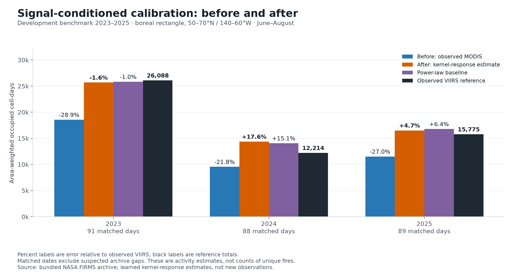
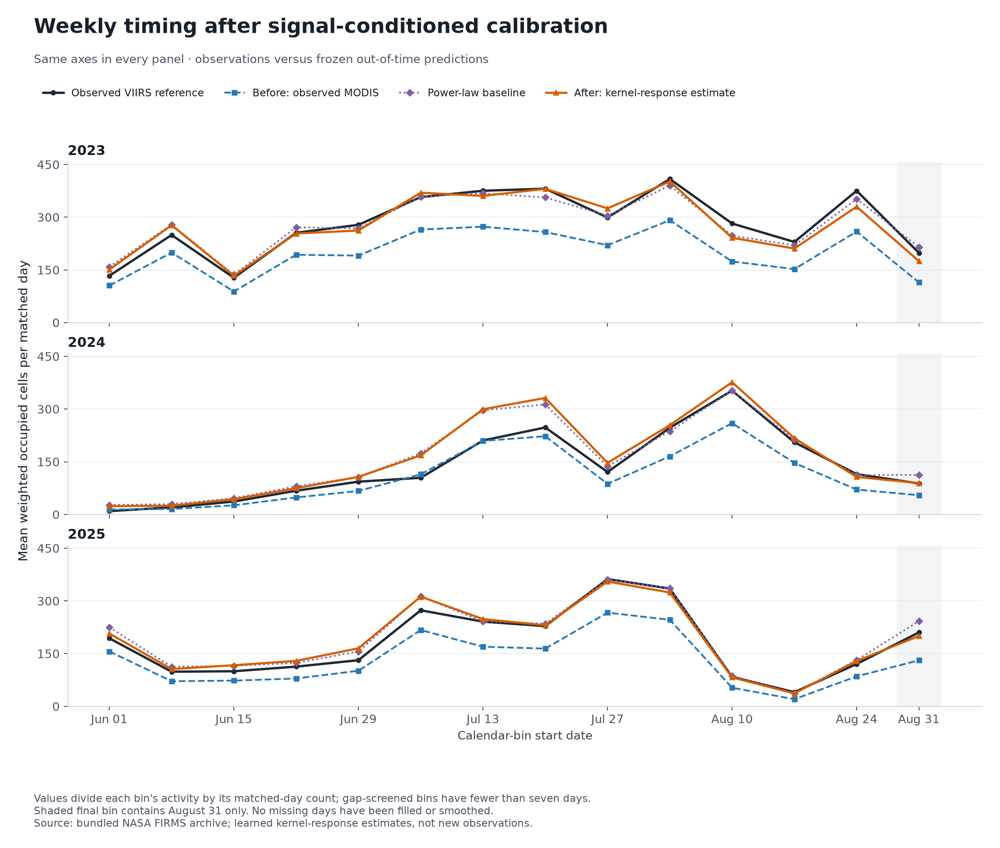
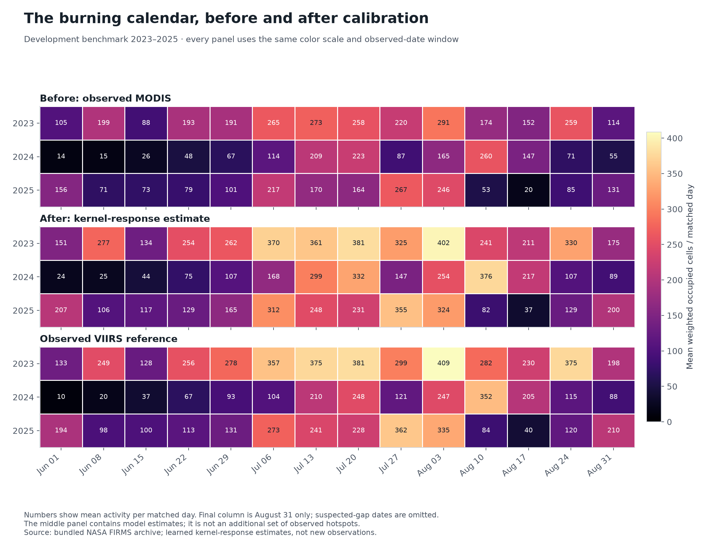
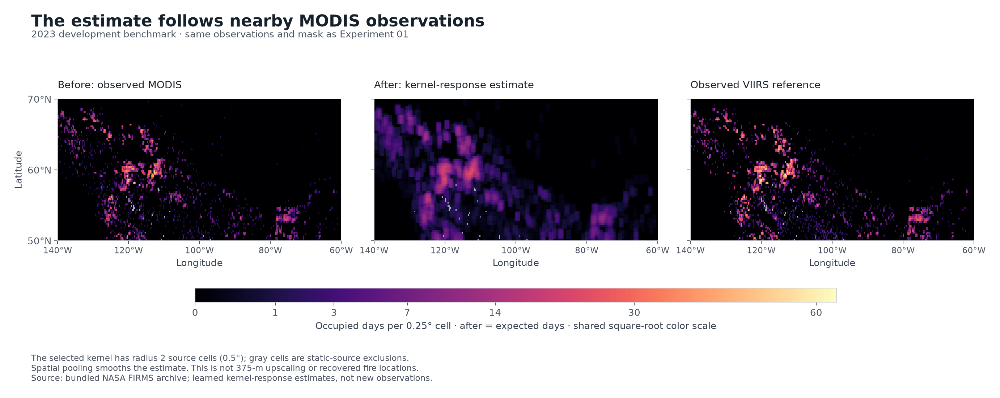
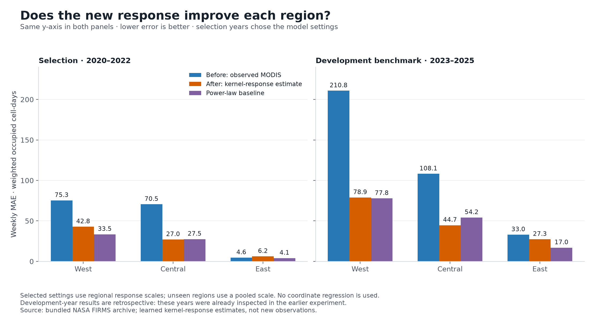
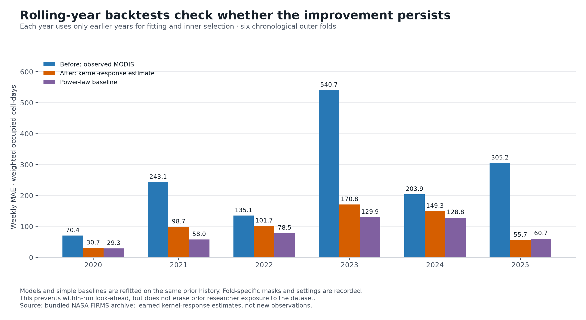

# Experiment 02: decision and visual evaluation

**The constrained model improves spatial transfer, but the power law remains the stronger overall calendar benchmark. Do not promote it.**

## Why this experiment

The first logistic model predicts a small nonzero background, extrapolates spatial coefficients, and uses past-day context. This experiment uses only the current day's local MODIS signal and a bounded, monotone Poisson-occupancy response. Training scales are fitted in the calendar's area-weighted cell-day units. These are established statistical building blocks; this particular adaptation was an experiment, not a known MODIS accuracy improvement.

Validation selected radius **2 source cells (0.5°)**, beta **0.75**, and regional pooling weight **1.0** from the frozen 27-setting candidate set. Original radiances/footprints are still unavailable, so native-resolution upscaling was not attempted.

## Comparable 2023–2025 development benchmark

All methods use the same 2012–2019 training history, training-only static mask and matched dates. The new settings use 2020–2022 selection data. **2023–2025 was already inspected in Experiment 01; this is not a fresh blind test.**

| Method | Weekly MAE | Aggregate bias | Worst matched-summer error |
|---|---:|---:|---:|
| Uncorrected MODIS | 348.8 | -26.7% | 28.9% |
| Original logistic model | 118.4 | -1.1% | 7.7% |
| New kernel response | 119.3 | +4.6% | 17.6% |
| Power law | 109.4 | +4.8% | 15.1% |

The new model reduces weekly MAE **65.8%** versus MODIS, but remains **9.1% worse** than the power law and **+0.8%** relative to the old logistic model. It beats raw MODIS in 36/42 bins and the power law in 20/42.

## What improved, and what did not

- Cold-east weekly MAE is **28.3**, versus **201.6** for the old spatially held-out logistic model. Aggregate bias is **+18.1%**, versus **+165.3%** previously. Both use west/central fitting and selection only. The new pooled fallback substantially reduces that failure.
- Cold-east worst matched-season relative error is still **96.6%**. An improved pooled average does not make quiet-region estimates reliable.
- Rolling-origin country weekly MAE is **101.2** for the new model and **80.9** for the power law. The simpler baseline also wins across the six-fold pooled backtest.
- Zero local MODIS signal now produces exactly zero prediction; the model cannot recover VIIRS-only activity outside that support. The support diagnostics report this limitation instead of filling isolated locations from a geographic prior.
- **11.7%–17.0%** of the benchmark VIIRS-reference activity lies outside that MODIS support. Regional count matching can compensate by assigning activity elsewhere. Better totals therefore do not establish better spatial localization.
- The response has a probabilistic form, but fitting matches aggregate counts. Cell-level probability calibration was not established.

## Peak-bin timing

Peaks use mean activity per matched day, exactly as the calendar figure. A week number is the bin beginning June 1 plus seven days per bin.

| Summer | VIIRS reference | Before MODIS | After kernel model | Power law |
|---|---|---|---|---|
| 2023 | 2023-08-03 | 2023-08-03 | 2023-08-03 | 2023-08-03 |
| 2024 | 2024-08-10 | 2024-08-10 | 2024-08-10 | 2024-08-10 |
| 2025 | 2025-07-27 | 2025-07-27 | 2025-07-27 | 2025-07-27 |

## Figures

Five original figure families are repeated, with a sixth rolling-backtest comparison. After = expected VIIRS-equivalent coarse-grid occupancy. These are not new detections or finer-resolution measurements.

### Matched-summer totals: observed MODIS, daily ML estimate, power-law estimate and observed VIIRS.

[PNG](../visualizations/01_summer_before_after.png) · [SVG](../visualizations/01_summer_before_after.svg)

### Weekly profiles normalized by matched days; common y-axis across all held-out years.

[PNG](../visualizations/02_weekly_before_after.png) · [SVG](../visualizations/02_weekly_before_after.svg)

### Before/after/reference calendars on one common color scale, with exact per-day values.

[PNG](../visualizations/03_calendar_before_after.png) · [SVG](../visualizations/03_calendar_before_after.svg)

### 2023 MODIS, kernel-response estimate, and observed VIIRS on a shared coarse grid.

[PNG](../visualizations/04_spatial_before_after_2023.png) · [SVG](../visualizations/04_spatial_before_after_2023.svg)

### Regional error before and after kernel-response calibration, compared with the power law.

[PNG](../visualizations/05_regional_errors.png) · [SVG](../visualizations/05_regional_errors.svg)

### Rolling-origin weekly error across 2020–2025 with matched-history baselines.

[PNG](../visualizations/06_rolling_backtests.png) · [SVG](../visualizations/06_rolling_backtests.svg)

## Validation and limits

The rolling protocol has six outer test years (2020–2025). In each, select settings using two immediately preceding years, then refit on all years before the outer test year. Baselines use the same history and masks. All earlier data had been publicly available and some results previously inspected, so the rolling procedure is a retrospective backtest, not an independent prospective trial.

The current geography, June–August scope, heuristic-gap screening and absence of clear-sky observation masks remain unchanged. Different final training histories in rolling folds make their scores incomparable to fixed-split scores without that qualification. Neighborhoods are defined in degrees; the model is a coarse activity calibration, not physical fire spread or satellite super-resolution. No model was retuned after reading its benchmark results, no pre-2012 reconstruction was published, and no main-app integration was performed.

## Recommendation

Retain the power law as the leading calendar benchmark. The new experiment shows that constraining spatial support can improve transfer, but does not establish a new best harmonizer. Before a native-footprint or upscaling experiment, acquire the original NASA measurements, geometry and observation masks. Keep all present outputs in research.

[Frozen protocol](../PROTOCOL.md) · [All metrics](metrics.csv) · [Selection candidates](fixed_validation_candidates.csv) · [Rolling fold ledger](rolling_fold_ledger.json) · [Support diagnostics](support_diagnostics.csv) · [Validation checks](validation.json)
