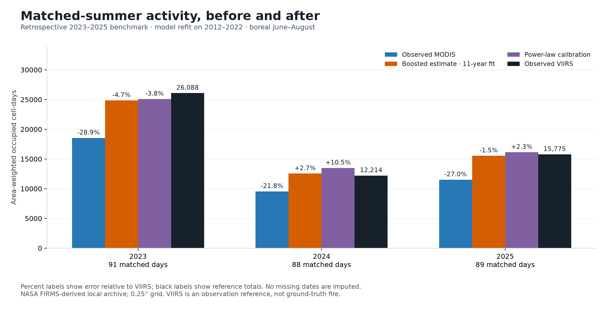
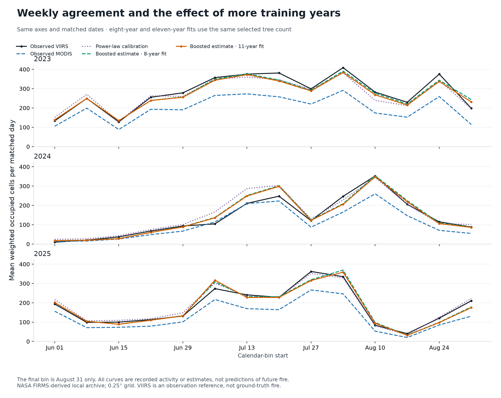
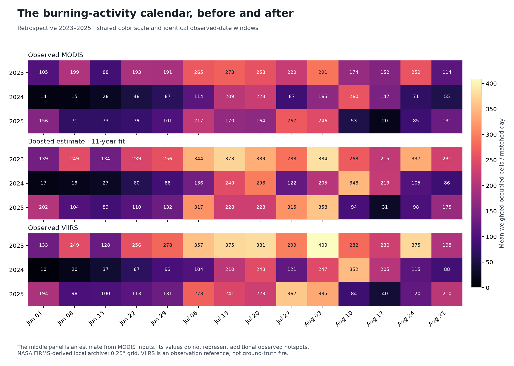
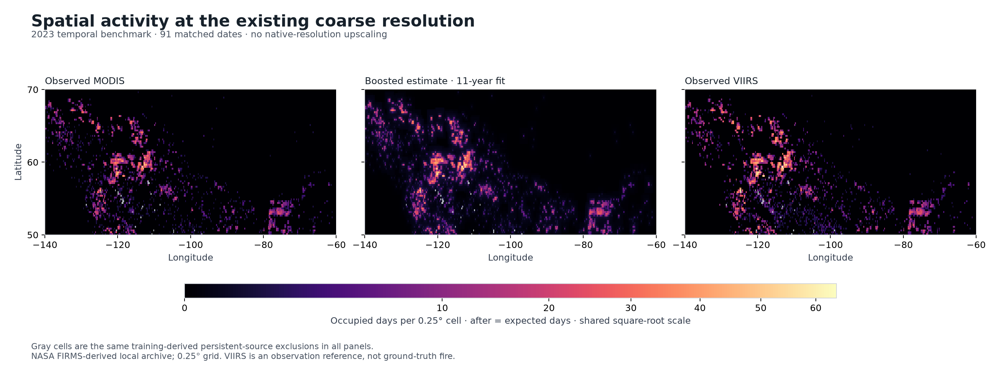
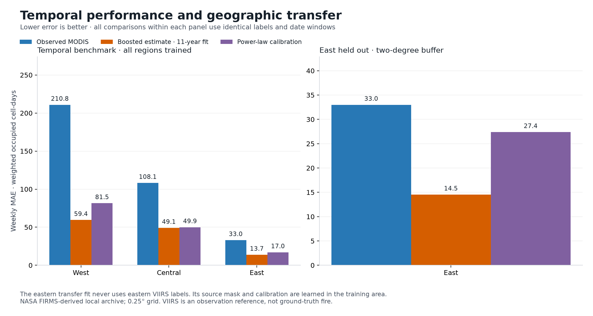
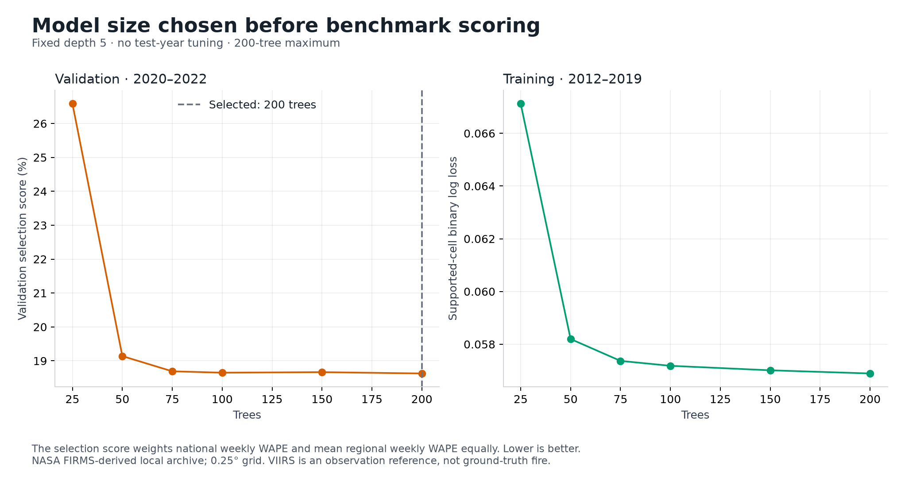

# Larger-model scientific figures

All before/after figures use the retrospective eleven-year benchmark model, evaluated in 2023–2025. The final fourteen-year refit is not presented as held-out evidence.

## Matched-summer totals for the eleven-year benchmark fit.

[SVG](01_summer_before_after.svg)

## Weekly activity includes eight-year and eleven-year boosted models on the same dates.

[SVG](02_weekly_before_after.svg)

## Before, after and reference calendars on a shared linear scale.

[SVG](03_calendar_before_after.svg)

## Shared-scale coarse maps reconcile exactly to the saved seasonal predictions.

[SVG](04_spatial_before_after_2023.svg)

## Regional temporal errors and a separately trained eastern transfer test.

[SVG](05_regional_errors.svg)

## Validation checkpoint selection and supported-cell training loss.

[SVG](06_training_selection.svg)
