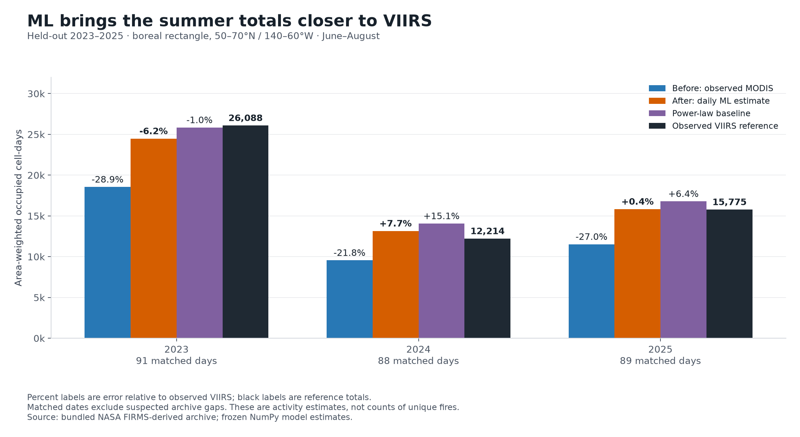
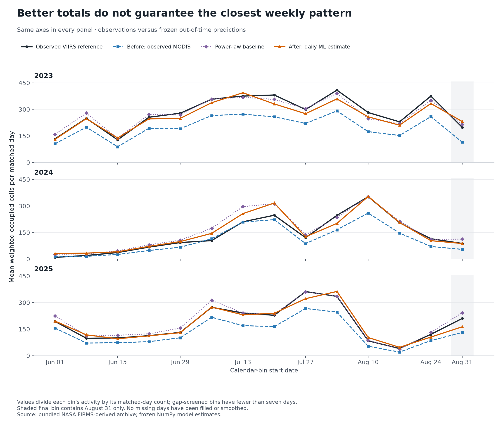
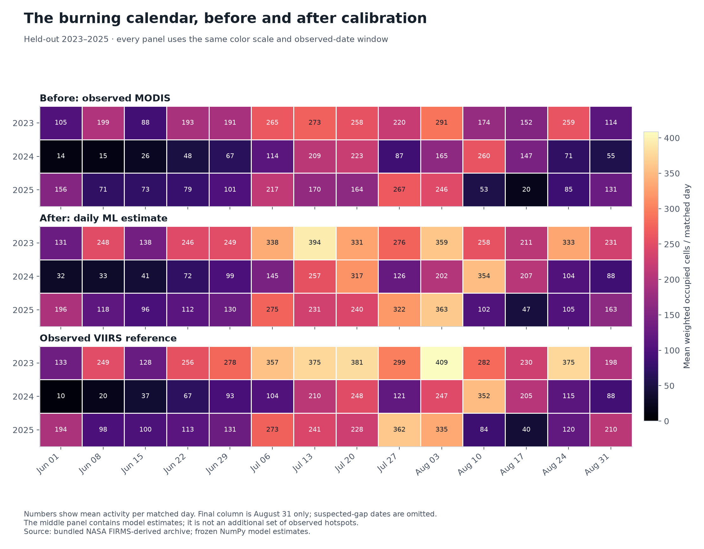
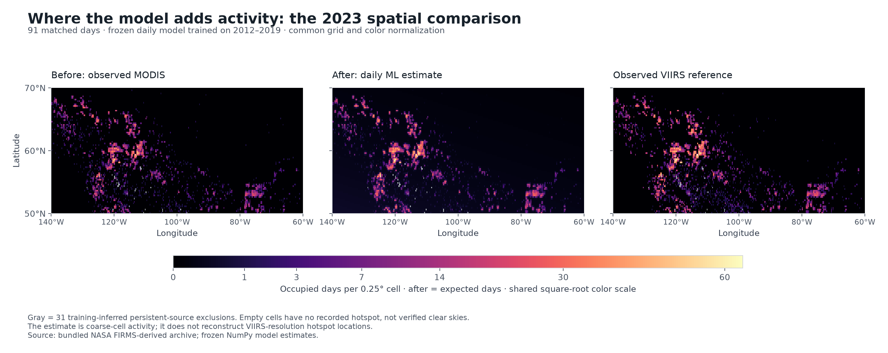
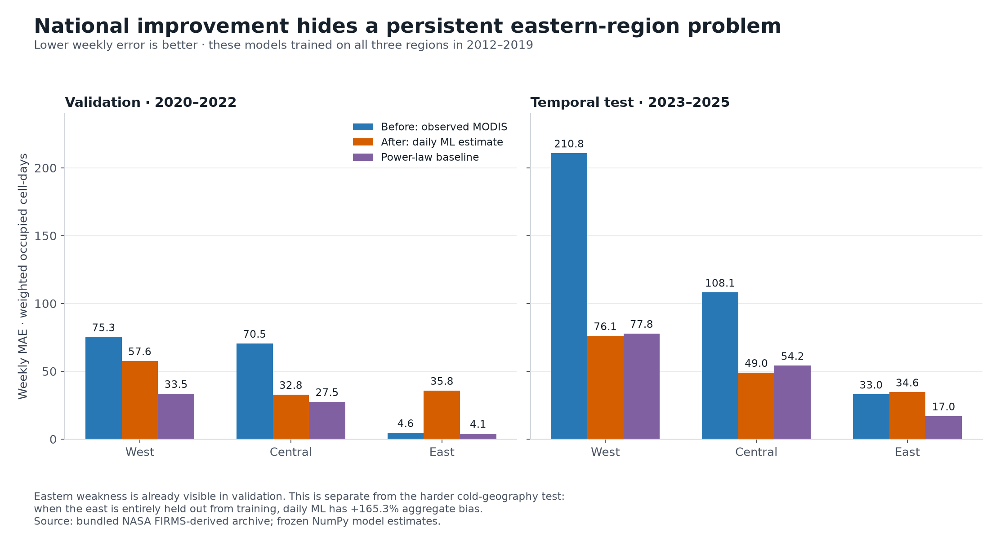

# Before and after MODIS calibration: evaluation

**The daily ML baseline improves agreement with observed VIIRS at the regional summer-total level. It is not yet a reliable general replacement for the power-law calibration.**

The before series is observed MODIS occupied-cell activity. The after series is the frozen NumPy logistic model's VIIRS-equivalent expected activity, computed from MODIS inputs. Observed VIIRS is a reference, not independent wildfire ground truth. No new detections were created.

## What the results support

- Weekly MAE falls from **348.8 to 118.4** weighted cell-days across the held-out rectangle: **66.1% lower** than uncorrected MODIS.
- ML beats uncorrected MODIS in **37 of 42** matched calendar bins, but beats the power law in only **17 of 42**.
- Aggregate bias changes from **-26.7% to -1.1%**. The near-zero aggregate can conceal errors with opposite signs in different weeks and regions.
- Worst matched-summer error falls from **28.9% to 7.7%**; the power law's worst error is 15.1%.

## Why the model should remain experimental

- The power law still has lower national weekly MAE: **109.4** versus **118.4**, making ML **8.2% worse** on that measure.
- Eastern validation MAE is **35.8** for ML versus **4.6** for uncorrected MODIS and **4.1** for the power law. This weakness was already observable without using the temporal test set to make a decision.
- When the east is completely excluded from training, ML aggregate bias is **+165.3%**. Spatial generalization is not established. Feature extrapolation/background predictions are plausible contributors, not proven causes.
- The weekly Poisson experiment underperforms even uncorrected MODIS; model family and target choice matter.
- LightGBM/Tweedie was not executed, so these plots do not establish whether boosted trees help.

## Peak-bin comparison

Peak means the bin with the highest activity per matched day. Bins are seven calendar days except the final August 31 bin; screened gap dates reduce some bins' observed-day count. This is descriptive timing, not an operational forecast test.

| Summer | VIIRS reference peak starts | MODIS peak starts | ML peak starts | Power-law peak starts |
|---|---|---|---|---|
| 2023 | 2023-08-03 | 2023-08-03 | 2023-07-13 | 2023-08-03 |
| 2024 | 2024-08-10 | 2024-08-10 | 2024-08-10 | 2024-08-10 |
| 2025 | 2025-07-27 | 2025-07-27 | 2025-08-03 | 2025-07-27 |

ML moves the peak bin **three weeks early in 2023** and **one week late in 2025**. Uncorrected MODIS and the power-law baseline preserve the reference peak bin in all three summers. This descriptive test is particularly relevant to a burning-calendar product: better summer totals do not establish better critical-period timing.

## Figures

All PNGs are accompanied by editable SVGs. Heatmap color scales and before/after map scales are shared. Season totals use actual matched-day sums; time profiles and calendars divide by matched days to avoid making short bins look artificially quiet.

### Matched-summer totals: observed MODIS, daily ML estimate, power-law estimate and observed VIIRS.

[PNG](../visualizations/01_summer_before_after.png) · [SVG](../visualizations/01_summer_before_after.svg)

### Weekly profiles normalized by matched days; common y-axis across all held-out years.

[PNG](../visualizations/02_weekly_before_after.png) · [SVG](../visualizations/02_weekly_before_after.svg)

### Before/after/reference calendars on one common color scale, with exact per-day values.

[PNG](../visualizations/03_calendar_before_after.png) · [SVG](../visualizations/03_calendar_before_after.svg)

### 2023 MODIS, ML-estimated VIIRS-equivalent activity, and observed VIIRS on the same 0.25-degree grid.

[PNG](../visualizations/04_spatial_before_after_2023.png) · [SVG](../visualizations/04_spatial_before_after_2023.svg)

### Regional MAE exposes eastern failure even before the cold-geographic stress test.

[PNG](../visualizations/05_regional_errors.png) · [SVG](../visualizations/05_regional_errors.svg)

## Interpretation limits and next step

Only 2023-2025 are shown as temporal holdouts. Dates are matched after suspected archive gaps are screened; the summer windows contain 91, 88 and 89 days. Static exclusions were fitted using training years only. The 0.25-degree pilot covers the 50-70N, 140-60W rectangle during June-August. Do not interpret colors as burned hectares or unique fires, the expected map as observed VIIRS points, or these results as a validated reconstruction of the pre-VIIRS era. No aggregate uncertainty intervals were established.

Keep the current model out of the main app. Use the power law as the serious benchmark while testing richer MODIS features, proper observation coverage and the planned boosted model. Regional validation must gate release; pooled national totals are insufficient. These results have now been inspected, so subsequent tuning requires fresh or nested blocked evaluation rather than treating the same years as untouched tests.

## Evidence and reproducibility

Run `src/validate_results.py`, then `src/visualize_results.py` from this research environment. No model fitting or app integration occurs during plotting.

- [Structured evaluation](visual_evaluation.json) and [regional breakdown](visual_evaluation_by_region.csv).
- [Weekly chart values](../visualizations/weekly_figure_data.csv).
- [Map reconciliation](map_reconciliation.json) and [figure/input manifest](visualization_manifest.json).
- [Original preliminary report](REPORT.md), [saved metrics](numpy_metrics.csv), [app isolation check](isolation_check.json).
