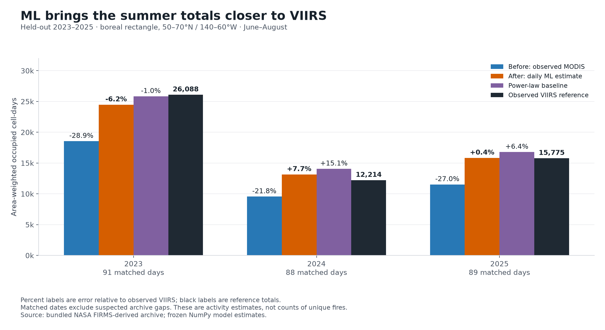
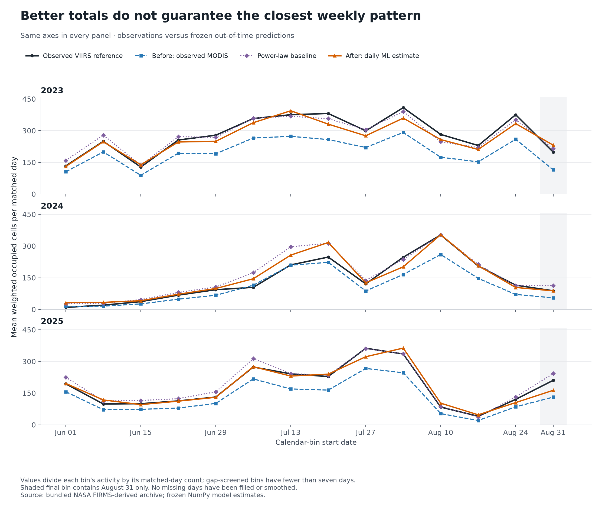
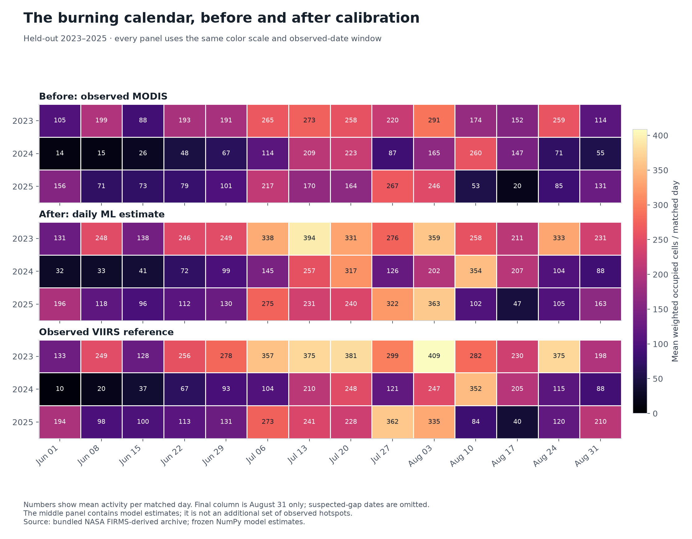
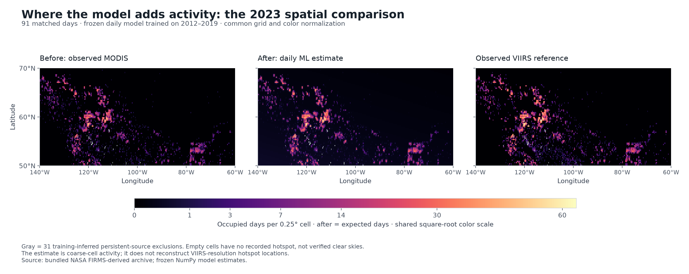
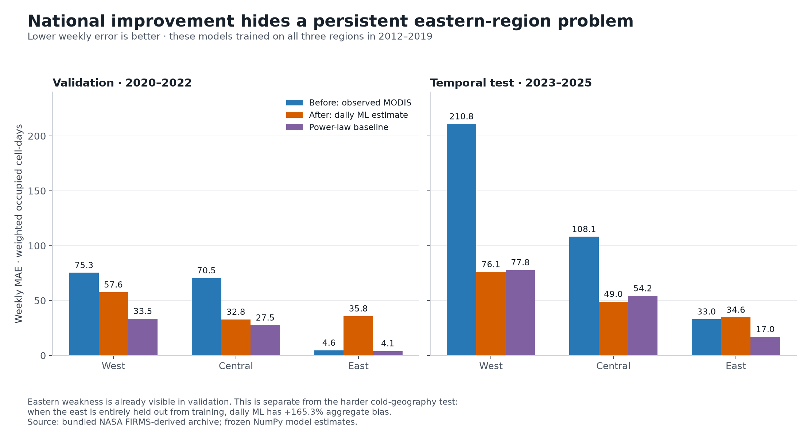

# MODIS before / after visualizations

[Read the evaluation and interpretation](../results/EVALUATION.md). Before = observed MODIS activity; after = model-estimated VIIRS-equivalent activity; reference = observed VIIRS.

## Matched-summer totals: observed MODIS, daily ML estimate, power-law estimate and observed VIIRS.

[PNG](01_summer_before_after.png) · [SVG](01_summer_before_after.svg)

## Weekly profiles normalized by matched days; common y-axis across all held-out years.

[PNG](02_weekly_before_after.png) · [SVG](02_weekly_before_after.svg)

## Before/after/reference calendars on one common color scale, with exact per-day values.

[PNG](03_calendar_before_after.png) · [SVG](03_calendar_before_after.svg)

## 2023 MODIS, ML-estimated VIIRS-equivalent activity, and observed VIIRS on the same 0.25-degree grid.

[PNG](04_spatial_before_after_2023.png) · [SVG](04_spatial_before_after_2023.svg)

## Regional MAE exposes eastern failure even before the cold-geographic stress test.

[PNG](05_regional_errors.png) · [SVG](05_regional_errors.svg)
